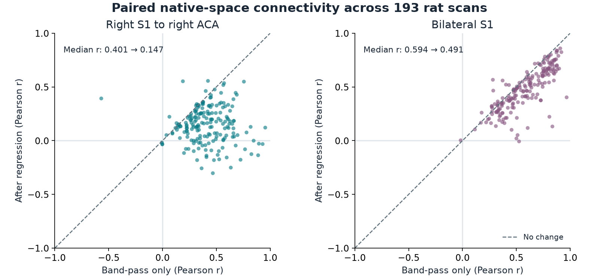
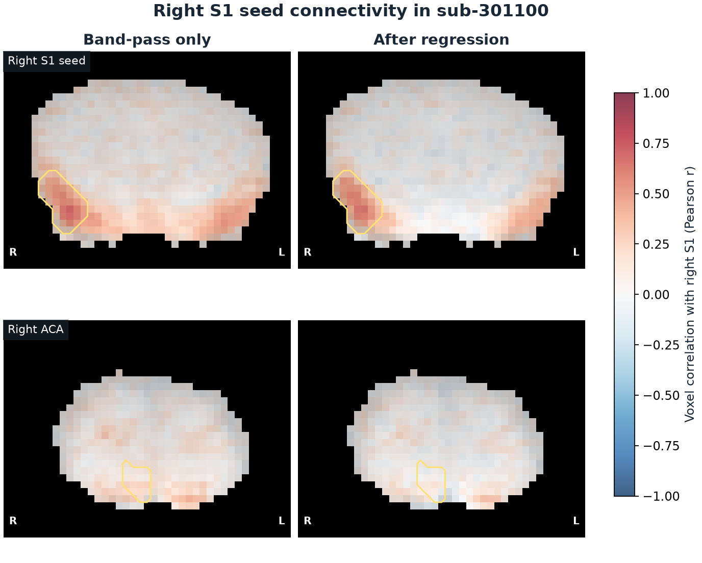

# Automatic nuisance regression for rat rs-fMRI

This standalone helper processes native-space AIDAmri Multiverse scans, one subject session at a time. It is staged here for evaluation before possible integration into AIDAmri 2.3. The current pipeline does not invoke it.

## Method

1. Use the native motion-corrected EPI after the first five volumes have been removed. Prefer the slice-time-corrected input and reuse the exporter's cached BET-masked copy when available. Check that the BET mask and the subject's warped SIGMA atlas match the EPI grid.
2. Load the three in-plane MCFLIRT estimates for each native slice (rotation around the slice normal and two in-plane translations). Drop the same first five rows and align the traces to the processed EPI by volume index. Kalthoff et al. showed that these motion estimates can capture some respiration-related apparent motion in rat EPI. Their original correction also used recorded physiology. [Kalthoff et al., 2011][kalthoff] · [MCFLIRT][mcflirt]
3. Form a nuisance mask from the warped SIGMA corpus callosum, other selected white-matter parcels, and ventricular parcels, intersected with the EPI brain mask. Detrend and zero-phase Butterworth band-pass the tissue time series at **0.01–0.20 Hz**, standardize each voxel, and take three principal components from the pooled tissue time series. Detrend and filter the BOLD and motion traces with the same passband. [CompCor][compcor] · [SIGMA][sigma] · [Matched temporal filtering][filtering]
4. For each slice, regress its standardized motion traces and the three scan-wide tissue components out of the filtered voxel series. Add back each voxel's input temporal mean. The default is ordinary least squares. `--ridge 300` reproduces the exploratory penalty on standardized coefficients and is available for comparison in a separate output directory.

This is a combination of published motion and tissue nuisance modeling with AIDAmri-specific inputs. The tissue components and motion traces are proxies for nuisance variation. The helper requires neither synchronized physiological traces nor a trained model. It writes native-space images without additional spatial smoothing. Standardized SIGMA-space resampling and scoring with the consortium's seed definitions remain subsequent steps. [AIDAmri processing][aida] · [Multiverse benchmark][benchmark]

## Run on the processed cohort

From the repository root, with Python 3.10 or newer and NumPy, SciPy, and NiBabel installed:

```sh
multiverse_root=/Volumes/Projects/Data_Cooperations/Multiverse
OPENBLAS_NUM_THREADS=1 VECLIB_MAXIMUM_THREADS=1 python3 \
  bin/helper_tools/regression_auto/Run_multiverse_regression.py \
  "$multiverse_root/proc_data_good" "$multiverse_root/proc_data_good_regression"
```

Add `--subject sub-300100` to run a single subject. Each completed `sub-*/ses-*/func` output contains the corrected NIfTI, `nuisance_regressors.tsv`, and `regression_qc.json`. The TSV contains the three tissue components and the filtered motion traces for all slices before regression-time standardization. The input directory is read-only during processing. A rerun skips complete outputs with matching model settings and reports failed sessions.

## Before and after regression

The 193 paired measurements below use native-space atlas parcels 521 and 522 for left and right barrel-field S1 and 502 for right cingulate (ACA). Values are Pearson correlations of parcel-mean time courses. Before and after use the same band-pass and omit 30 seconds at each edge for scoring.



Across the cohort, median absolute right S1–ACA was **0.405 → 0.163** and declined in **177 of 193** scans. Median bilateral S1 was **0.594 → 0.491**. The decrease in bilateral S1 is part of the trade-off to check before pipeline integration.



The map uses the same fixed correlation scale in all panels. Yellow outlines mark the right S1 seed in the top row and right ACA in the bottom row. Both stages are shown on the same mean native EPI.

| Example session | Bilateral S1 before | Bilateral S1 after | Right S1–ACA before | Right S1–ACA after |
| --- | ---: | ---: | ---: | ---: |
| [sub-300100](examples/sub-300100.zip) | 0.787 | 0.780 | 0.459 | 0.334 |
| [sub-301100](examples/sub-301100.zip) | 0.751 | 0.651 | 0.440 | 0.058 |
| [sub-301808](examples/sub-301808.zip) | 0.270 | 0.318 | 0.308 | 0.328 |

The examples show a modest decrease, a larger decrease, and a small increase in S1–ACA. These are descriptive QC measurements using the branch atlas. They do not establish that the removed covariance is physiological noise.

## Re-test the three examples

Each ZIP contains one complete 995-volume session with the processed EPI, BET mask, warped atlas, sidecar, original slice motion tables, and `expected_qc.json`. The example EPI is the cached, already-masked native input stored under the script's standard input filename. The scans are AIDAmri derivatives of the public StandardRat dataset. [StandardRat publication][standardrat] · [Source dataset, CC0][dataset]

From the repository root:

```sh
work_dir=$(mktemp -d "${TMPDIR:-/tmp}/aida-regression.XXXXXX")
mkdir "$work_dir/input"
for archive in bin/helper_tools/regression_auto/examples/*.zip; do
  unzip -q "$archive" -d "$work_dir/input"
done
OPENBLAS_NUM_THREADS=1 VECLIB_MAXIMUM_THREADS=1 python3 \
  bin/helper_tools/regression_auto/Run_multiverse_regression.py \
  "$work_dir/input" "$work_dir/output"
```

Compare each output `regression_qc.json` with the corresponding input subject's `expected_qc.json`. The correlation values should agree to the precision shown in the table. Component signs may differ across numerical libraries while producing the same fitted nuisance contribution.

## References

1. Kalthoff D. *Functional Connectivity of the Rat Brain in Magnetic Resonance Imaging*. RWTH Aachen University dissertation, 2011. Chapter IV.1, “Physiological Noise in Functional MRI Data.”
2. Kalthoff D, Seehafer JU, Po C, Wiedermann D, Hoehn M. Functional connectivity in the rat at 11.7 T: impact of physiological noise in resting state fMRI. *NeuroImage* 54, 2828–2839 (2011). [doi:10.1016/j.neuroimage.2010.10.053][kalthoff]
3. Behzadi Y, Restom K, Liau J, Liu TT. A component based noise correction method (CompCor) for BOLD and perfusion based fMRI. *NeuroImage* 37, 90–101 (2007). [doi:10.1016/j.neuroimage.2007.04.042][compcor]
4. Hallquist MN, Hwang K, Luna B. The nuisance of nuisance regression: spectral misspecification in a common approach to resting-state fMRI preprocessing reintroduces noise and obscures functional connectivity. *NeuroImage* 82, 208–225 (2013). [doi:10.1016/j.neuroimage.2013.05.116][filtering]
5. Jenkinson M, Bannister P, Brady M, Smith S. Improved optimization for the robust and accurate linear registration and motion correction of brain images. *NeuroImage* 17, 825–841 (2002). [doi:10.1016/S1053-8119(02)91132-8][jenkinson]
6. Barrière DA et al. The SIGMA rat brain templates and atlases for multimodal MRI data analysis and visualization. *Nature Communications* 10, 5699 (2019). [doi:10.1038/s41467-019-13575-7][sigma]
7. Pallast N et al. Processing pipeline for atlas-based imaging data analysis of structural and functional mouse brain MRI (AIDAmri). *Frontiers in Neuroinformatics* 13, 42 (2019). [doi:10.3389/fninf.2019.00042][aida]
8. Grandjean J et al. A consensus protocol for functional connectivity analysis in the rat brain. *Nature Neuroscience* 26, 673–681 (2023). [doi:10.1038/s41593-023-01286-8][standardrat] · [StandardRat ds004116][dataset] · [Multiverse pipeline descriptions][benchmark]

[kalthoff]: https://doi.org/10.1016/j.neuroimage.2010.10.053
[compcor]: https://doi.org/10.1016/j.neuroimage.2007.04.042
[filtering]: https://doi.org/10.1016/j.neuroimage.2013.05.116
[jenkinson]: https://doi.org/10.1016/S1053-8119(02)91132-8
[mcflirt]: https://fsl.fmrib.ox.ac.uk/fsl/docs/registration/mcflirt.html
[sigma]: https://doi.org/10.1038/s41467-019-13575-7
[aida]: https://doi.org/10.3389/fninf.2019.00042
[standardrat]: https://doi.org/10.1038/s41593-023-01286-8
[dataset]: https://openneuro.org/datasets/ds004116/versions/1.0.0
[benchmark]: https://github.com/grandjeanlab/multiverse/blob/main/pipeline.md
